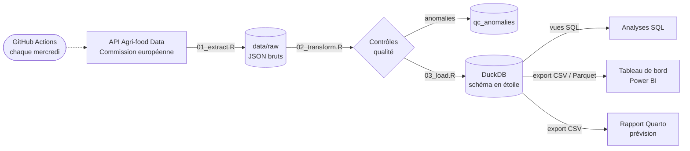

# Observatoire des prix du porc en Europe

Pipeline de données automatisé (R, SQL, DuckDB), tableau de bord Power BI et
rapport de prévision sur les prix et la production de porc dans l'Union
européenne, à partir des données ouvertes de la Commission européenne.

**Rapport de prévision en ligne :** https://remesha.github.io/observatoire-prix-porc/

---

## Ce que fait le projet



1. **Extract** — interroge l'API (cotations hebdomadaires des carcasses S, E, R
   et des porcelets ; production mensuelle) pour tous les États membres depuis
   2015. Les réponses brutes sont conservées telles quelles. Les années
   anciennes sont mises en cache ; les deux dernières sont ré-extraites à chaque
   exécution, car la Commission peut réviser les dernières semaines.
2. **Transform** — harmonise les formats (dates, semaines ISO, unités : €/kg de
   carcasse et €/tête) et applique huit règles de contrôle qualité. Les lignes
   invalides sont écartées ; les autres anomalies sont signalées et historisées.
3. **Load** — charge un modèle en étoile dans DuckDB de façon **idempotente**
   (clés primaires et `INSERT OR REPLACE` : relancer le pipeline ne crée aucun
   doublon), trace chaque exécution dans un journal, crée des vues analytiques
   et exporte les tables pour Power BI.
4. **Automatisation** — GitHub Actions lance les tests, le pipeline et le
   rapport chaque semaine, publie les données actualisées dans le dépôt et le
   rapport sur GitHub Pages.

## Un exemple de ce que le contrôle qualité apporte

Lors du premier chargement, la règle « semaines manquantes » a signalé une
semaine absente chaque début janvier dans presque toutes les séries. Ce n'était
pas un trou dans les données publiées, mais un défaut de l'extraction :
l'API ne renvoie une semaine que si elle est entièrement comprise dans la
période demandée, et la semaine à cheval sur deux années (par exemple du
29/12/2025 au 04/01/2026) tombait entre deux requêtes annuelles.

Correction : chaque requête annuelle déborde d'une semaine sur janvier suivant,
et le recouvrement est dédoublonné (sans alerte si les valeurs sont identiques,
avec une alerte `doublon_conflictuel` sinon). Les alertes « semaines
manquantes » sont passées de 968 à 272 ; celles qui restent correspondent à de
vraies interruptions de publication (pays baltes, Slovaquie, République
tchèque...). Un test automatisé couvre ce cas.

## Structure du dépôt

```
├── run_pipeline.R              orchestration (point d'entrée)
├── R/
│   ├── 00_config.R             paramètres (périmètre, seuils, chemins)
│   ├── utils.R                 journalisation, fonctions de lecture
│   ├── 01_extract.R
│   ├── 02_transform.R          harmonisation + contrôles qualité
│   └── 03_load.R               chargement DuckDB + export Power BI
├── sql/
│   ├── 01_schema.sql           modèle en étoile
│   └── 02_vues.sql             vues analytiques
├── analyse/prevision_prix.qmd  rapport Quarto : saisonnalité, prévision
├── powerbi/
│   ├── GUIDE_POWERBI.md        construction du tableau de bord pas à pas
│   ├── requetes_power_query.m  chargement des données (langage M)
│   ├── mesures.dax             mesures DAX
│   └── theme_observatoire.json
├── tests/                      tests unitaires et test d'idempotence
├── data/
│   ├── raw/                    réponses brutes de l'API (versionnées)
│   ├── powerbi/                tables exportées (CSV versionnés, Parquet local)
│   └── qc/                     rapport qualité de la dernière exécution
├── docs/dictionnaire_donnees.md
└── .github/workflows/pipeline.yml
```

## Lancer le projet

Prérequis : R ≥ 4.2 et, pour le rapport, [Quarto](https://quarto.org).

```bash
Rscript install_packages.R       # une seule fois
Rscript tests/testthat.R         # tests
Rscript run_pipeline.R           # pipeline complet (environ 1 minute)
quarto render analyse/prevision_prix.qmd
```

La base `data/db/observatoire_porc.duckdb` peut ensuite être interrogée en SQL :

```r
con <- DBI::dbConnect(duckdb::duckdb(), "data/db/observatoire_porc.duckdb", read_only = TRUE)
DBI::dbGetQuery(con, "SELECT * FROM v_classement_derniere_semaine ORDER BY rang")
```

## Modèle de données

Deux tables de faits partagent les dimensions pays et dates :

- `fait_prix_hebdo` (pays × classe × semaine) — reliée à `dim_pays`,
  `dim_classe`, `dim_date` ;
- `fait_production_mensuelle` (pays × mois) — reliée à `dim_pays`, `dim_date`.

Détail des colonnes, des unités et des règles qualité :
[docs/dictionnaire_donnees.md](docs/dictionnaire_donnees.md).

## Rapport de prévision

Le rapport [`analyse/prevision_prix.qmd`](analyse/prevision_prix.qmd) étudie le
prix de la classe E en France : comparaison avec la moyenne européenne,
saisonnalité (décomposition STL), puis comparaison de cinq méthodes de
prévision à 1–12 semaines par **validation croisée à origine glissante**, et
prévision avec intervalles de confiance. Il présente aussi les limites des
modèles univariés.

<!--
## Aperçu du tableau de bord

| Vue d'ensemble | Comparaison européenne |
|---|---|
|  |  |
| **Production** | **Qualité des données** |
|  |  |

Fichiers : [`powerbi/observatoire_prix_porc.pbix`](powerbi/observatoire_prix_porc.pbix)
· [version PDF](powerbi/observatoire_prix_porc.pdf)
-->

## Limites

- Les prix publiés par la Commission sont des cotations nationales déclarées
  par les États membres ; leurs méthodes de relevé ne sont pas totalement
  homogènes d'un pays à l'autre.
- Les unités de la production ne sont pas documentées par l'API : elles ont
  été déduites et vérifiées par un contrôle de cohérence interne.
- En CI, la base DuckDB est reconstruite à chaque exécution à partir des
  fichiers bruts versionnés ; le journal des chargements n'est donc conservé
  qu'en local.

## Source et licence

Données : Commission européenne, portail Agri-food Data — réutilisation
autorisée avec mention de la source.
Code : licence MIT.

Auteur : Guy Darcy Remesha — [LinkedIn](https://www.linkedin.com/in/guy-darcy-remesha-07a27819a/)
